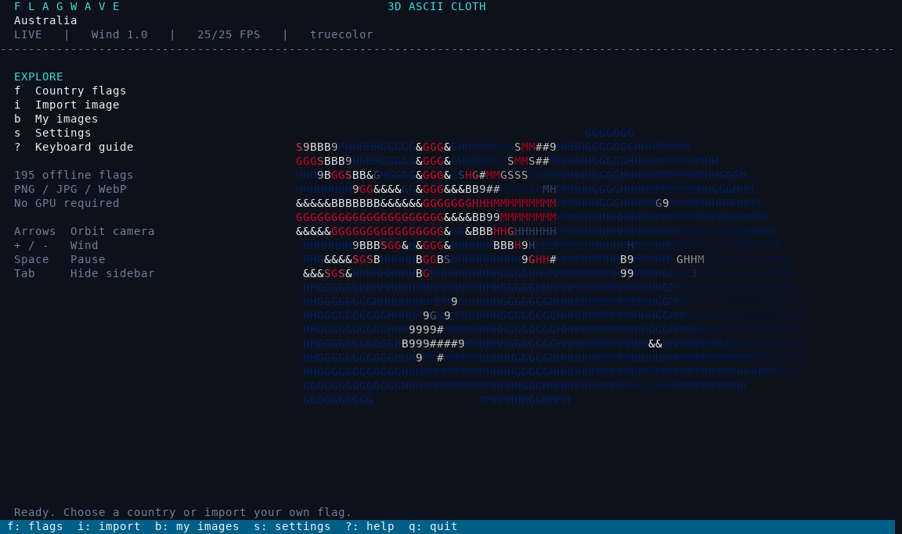

# FlagWave

An animated 3D ASCII flag for Fedora Asahi and other Linux terminals.
Python + NumPy + Pillow; no GPU, desktop session, pip, or compilation required.

## Install on Linux (curl)

```bash
curl -fsSL https://raw.githubusercontent.com/Mandrusian/FlagWave/main/install.sh | bash
```

Then run `~/.local/bin/flagwave au`, or `flagwave au` if `~/.local/bin` is in PATH.
Open the historical/alternate collection with `flagwave --archive` or press **a**.

The same installer supports Fedora/Asahi, Debian/Ubuntu, Arch, openSUSE, Alpine
and Void using their native packages. On other Linux distributions it uses a
Python virtual environment if Python 3.10+, venv and pip are already available.
Install those prerequisites with your distro's package manager if prompted.
This is Linux support, not a claim that every distribution was hardware-tested.
Root access is used only to install missing distro packages. The application
installs into your home directory, and saved imports survive updates.

For a local checkout, run `bash install.sh`. No GPU or display server is needed.

## Examples

```bash
flagwave
flagwave rek
flagwave eureka
flagwave eu
flagwave au
flagwave china
flagwave ussr
flagwave ussr-1936
flagwave nazi-germany
flagwave --archive
flagwave --list-archive
flagwave "United Kingdom"
flagwave --random
flagwave --image ~/Pictures/my-flag.png
flagwave --vertical --image ~/Pictures/banner.jpg
flagwave --mono
flagwave --color 256 --fps 20
flagwave --wind 1.7
flagwave --list
```

PNG, JPEG, WebP, BMP, TIFF and Pillow-supported images work. Animated GIFs use
the first frame. Alpha is used to cut out transparent areas (including Nepal's
nonrectangular flag); partially transparent pixels use a 100/255 threshold.
Raster image aspect ratios are preserved before the cloth is deformed.
SVG is not supported: export it to PNG first.

## Historical, wartime and political flags

**170 additional designs**, alongside the 195 country flags. Press **a** for the
archive; type to search by name, ID, period or category. **Ctrl-F / Ctrl-R**
cycles category filters; **Ctrl-O** shows dates, attribution and the source.
Press **d** on the stage to inspect the active archive flag.

The collection includes the USSR (WWII-era and later designs), all 15 Soviet
republics, East Germany, Yugoslavia, Nazi Germany and its war ensign, Italian
fascist party and RSI flags, the British Union of Fascists, Imperial Japanese
army/naval flags, Allied WWII flags, imperial/monarchist and republican flags,
anarchist variants, a red socialist flag and the Gadsden flag. Civil, national,
party, military, personal and symbolic designs have distinct labels.

All entries use the same controls, rendering and alphabetical presentation.
Labels describe historical use and political association without endorsement.
Symbolic ideology flags are representative designs, not universal official
standards. The archive is a growing selection rather than an exhaustive list.

[Artwork sources, credits, periods and licenses](ARCHIVE-SOURCES.md) are bundled
with the project, so the entire archive works offline. Original images were
resized/rasterized into palette PNG; the flag designs were not altered.

## Interactive TUI



The stage has a collapsible sidebar, live status and camera controls. Open the
country picker with **f** and type a name or code to filter all 195 flags.
The selected flag has an animated preview in wide terminals.

Press **i** to open the built-in image browser. Navigate folders with up/down
and Enter. The left arrow opens the parent folder. Type to filter filenames;
Backspace edits the filter. Press **Ctrl-G** to enter or paste a full file or
directory path, or **Ctrl-D** to show hidden files. Enter on an image imports
it and starts the animation. Esc cancels without changing the current flag.

Imported images are copied as PNGs into
`${XDG_DATA_HOME:-~/.local/share}/flagwave/imports`. Press **b** to open **My
images** and reuse one later, even if the original file has been moved. Imports
preserve the source aspect ratio and alpha mask and are resized to a maximum
of 640 pixels for terminal rendering. Identical images with the same name are
not duplicated. The CLI `--image` option previews the source file directly
without adding it to My images.

| Key on the stage | Action |
| --- | --- |
| f or / | Search country flags |
| a | Historical / military / political archive |
| d | Details and attribution of the active archive flag |
| i | Browse folders and import an image |
| b | Open saved imports |
| s | Settings: wind, target FPS, colour, orientation, ASCII style |
| ? | Keyboard guide |
| Tab | Toggle sidebar |
| Left/right or h/l | Orbit the camera |
| Up/down or k/j | Tilt the camera |
| + / - | Raise/lower wind |
| Space | Pause/resume |
| n / p | Next/previous country |
| v | Rotate artwork into a vertical banner |
| c | Cycle truecolor / 256 colours / monochrome |
| r | Reset camera and wind |
| q | Quit from the stage |

Ctrl-C quits from any screen. In pickers, use arrows and Enter; type to search;
Esc returns to the stage; Tab switches between countries, the archive, the browser and My images.
PgUp/PgDn scroll by 12 entries. Smaller terminals hide the preview/sidebar.

## Publish to GitHub

```bash
bash publish-github.sh
```

This creates **public** repository `Mandrusian/FlagWave`, commits the project,
and pushes it to `main`. It installs Fedora's `gh` and `git` packages if needed
and opens GitHub's login flow if you are not authenticated. It requires the
Mandrusian account and stops if that repository or local Git history already
exists, so it never overwrites existing work.

A GitHub Actions workflow checks the 195 assets, cloth animation, searchable
picker, image import/reuse, error handling, batched keyboard input and terminal
cleanup on Python 3.11 and 3.13. Run the same checks locally with:

```bash
python3 -m unittest discover -s tests -v
```

The cloth is pinned along its left edge and waves vertically and in depth.
The vertical toggle rotates the artwork; it does not change the pinned edge.
The effect is procedural cloth animation rather than a physical cloth solver.
Supersampled surface points, perspective projection, a depth buffer, and
surface-normal lighting create the 3D movement. ASCII characters form the image;
ANSI foreground colors carry the flag colors. `--mono` removes color sequences
while retaining terminal cursor control. `--blocks` uses solid ASCII `#` marks.

Use a modern terminal such as Konsole, Kitty, GNOME Terminal or foot. Truecolor
is the default. Smaller fonts and a larger terminal show more emblem detail.
The app adapts to terminal resizing. Use `--fps 15` if your terminal is slow;
FPS is a target, and actual speed depends on terminal dimensions and hardware.
The renderer caps sampling density to limit CPU use in huge windows.

The original terminal screen, cursor and input mode are restored on normal quit,
Ctrl-C, exceptions and SIGTERM. SIGKILL/power loss cannot be handled.

## Included flags

195 entries: the 193 UN member states, plus Palestine and Vatican City (Holy See).
All images are included; runtime network access is not required. Country names
come from Flagpedia's English country-code catalogue. Flag artwork is a snapshot
of the provider's designs when downloaded on 29 October 2026, including its
choices for disputed or changing national flags. A different design can be
loaded with `--image`.

Flag assets: https://flagpedia.net/download/api and https://flagcdn.com/ .
Flagpedia describes its country flag images as public-domain artwork based on
Wikimedia Commons. Source URLs follow `https://flagcdn.com/w320/au.png`.
The program's MIT license does not change the status of the flag images.

## Uninstall

```bash
rm -f "$HOME/.local/bin/flagwave"
rm -rf "${XDG_DATA_HOME:-$HOME/.local/share}/flagwave"
```

## Older laptops and tiny terminal fonts

The default is Red Eureka (`rek` / `red-eureka`), a red-field reconstruction
with a white Eureka cross and stars. Use `flagwave eureka` for the blue design,
or `flagwave eu` for the EU flag. The archive now also includes regional flags
and all 50 US state flags. Artwork sources are in ARCHIVE-SOURCES.md.

Auto quality is the default: 20 FPS target, lower sampling cost and automatic
quality/canvas reduction when rendering misses the frame budget. The animation
is capped at 140 x 50 cells even in a huge terminal with tiny fonts. It stays
centred instead of scaling CPU and output traffic with the full window size.
The entire TUI is also capped at 220 x 75 cells and centred, so file pickers
and menus cannot flood the terminal when fonts are tiny. Static stage areas
are no longer erased/redrawn on every frame.

For older laptops, including Intel MacBooks on Arch:

```bash
flagwave --low-power
```

Low power uses 12 FPS and at most 90 x 34 animated cells. `--quality high`
raises the cap to 200 x 70; `--fps 15` sets a lower target independently.
Performance still depends on the CPU, terminal emulator and system load.

## Automatic 3D orbit

```bash
flagwave --orbit
flagwave --low-power --orbit
flagwave eu --orbit --orbit-speed 4
```

Press **o** on the stage (or toggle **Auto orbit** in settings) for a full slow
360-degree camera rotation while the cloth waves. The default speed is 6 degrees
per second, one turn per minute. `--orbit-speed -6` reverses the direction.
Space pauses both the cloth and orbit. Browsing menus holds the camera position;
returning resumes the orbit. Arrow keys still adjust the camera angle and tilt.
The existing canvas limits and adaptive sampling apply during orbit too.

Change orbit speed live with **[** (slower) and **]** (faster), in 0.5-degree/sec
steps. **Backslash** reverses direction. Settings (**s**) has separate **Orbit
speed** and **Orbit direction** rows; use left/right to change them. Speed is
limited to 0.1–60 degrees/sec; changing it keeps the current direction and angle.
Normal mode: `flagwave --orbit`. Low power is optional: `flagwave --low-power --orbit`.
